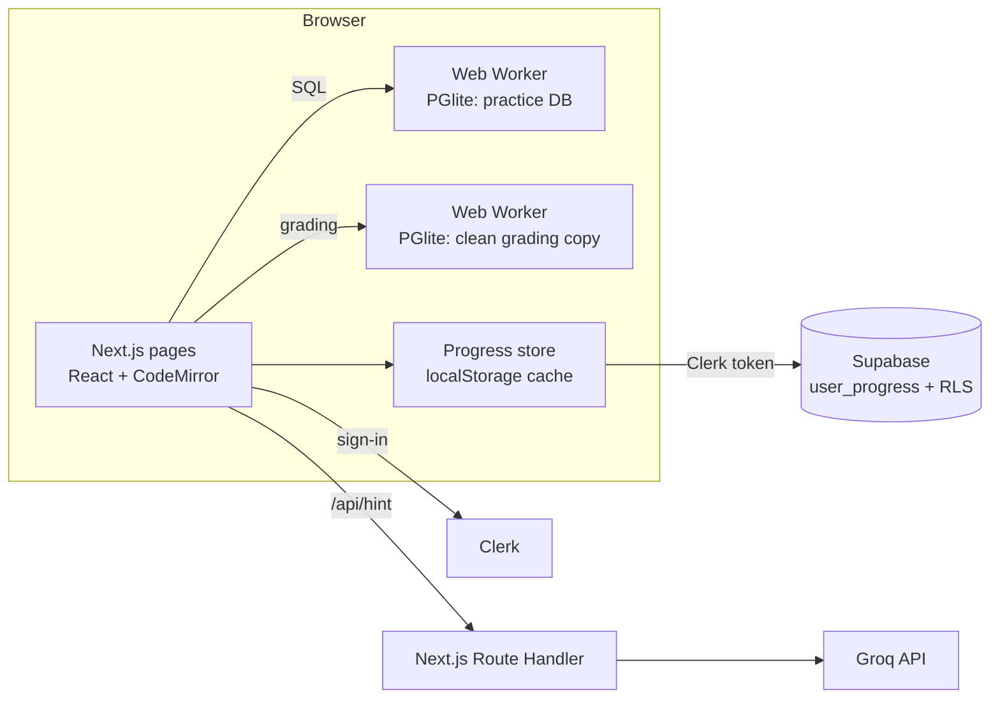

# 🥋 SQL Dojo

**Learn SQL by writing SQL.** SQL Dojo is a free, hands-on platform for learning and practicing SQL.
Every query runs on a **real PostgreSQL database inside your browser tab**, compiled to WebAssembly with
[PGlite](https://pglite.dev). Feedback is instant, there's no database server to pay for or secure, and nobody
can break anything for anyone else.

- **87 practice problems** · **15 lessons** · **16 topics** · **7 realistic datasets**
- Instant auto-grading, an AI tutor, XP, streaks, badges and a daily challenge
- Lessons and problems are free to browse; a free account is needed to run queries and save progress

---

## Table of contents

- [Features](#features)
- [Tech stack](#tech-stack)
- [How it works](#how-it-works)
- [Getting started](#getting-started)
- [Environment variables](#environment-variables)
- [Setting up the services](#setting-up-the-services)
- [Scripts](#scripts)
- [Deploying to Vercel](#deploying-to-vercel)
- [Adding content](#adding-content)
- [Project structure](#project-structure)
- [Security and privacy](#security-and-privacy)
- [Known limitations](#known-limitations)
- [Roadmap](#roadmap)

---

## Features

### 🧩 Practice problems
- **87 problems**: 38 Easy, 36 Medium and 13 Hard, ordered as a curriculum: CRUD basics first
  (CREATE TABLE → INSERT → SELECT → UPDATE → DELETE), then strings, dates, CASE, aggregates, GROUP BY, JOINs,
  subqueries, CTEs and window functions.
- **Instant auto-grading.** The grader compares your result with the official solution's result. It ignores column
  names, column order and row order unless the problem asks for a specific order, and tolerates formatting
  differences such as `5` vs `5.00`.
- **CRUD problems are graded by table state.** For INSERT, UPDATE, DELETE and CREATE TABLE, a check query
  inspects the data your statement leaves behind. CREATE TABLE checks test *behavior*: for example, they make sure
  your CHECK constraint really rejects a bad rating.
- **Clear feedback on wrong answers:** your output and the expected output side by side, with the wrong rows
  highlighted.
- **Hints** revealed one at a time, and a **solution** that unlocks after you solve the problem or give up.
- **Filters** by difficulty, topic, dataset and status (to do / attempted / solved), plus search.

### 📚 Learning path
- **15 short lessons**, from `CREATE TABLE` and `SELECT` to JOINs, CTEs and window functions.
- Each lesson has syntax-highlighted examples and a live **"Try it" editor**. Changes are undone after every run,
  so examples can be re-run safely. Each lesson links to related practice problems.

### 🗄️ Seven realistic datasets (all fictional)

| Dataset | Tables | Problems |
|---|---|---|
| 🏢 Company | departments, employees, projects, employee_projects | 30 |
| 🛒 Online Shop | customers, products, orders, order_items | 13 |
| 🏏 Cricket League | teams, players, matches, player_stats | 8 |
| 🏥 Hospital | doctors, patients, appointments, prescriptions | 9 |
| 🏦 Bank | branches, customers, accounts, transactions, loans | 9 |
| 🎬 Movies | directors, movies, actors, movie_cast | 9 |
| 🎓 School | teachers, courses, students, enrollments (includes absentees as NULL marks) | 9 |

### 💻 The editor
- CodeMirror with SQL highlighting, **autocomplete for table and column names**, and **Ctrl/Cmd + Enter** to run.
- **Schema panel** with each table's columns, types, row counts and sample rows.
- **Reset DB** undoes any changes you made to the practice data.
- Runaway queries are stopped after 8 seconds, and the page never freezes because the database runs in a Web Worker.

### 🤖 AI tutor (optional)
- **"Ask the AI tutor"** explains what's wrong with *your* query in 2–4 sentences, pointing at the exact part to fix,
  **without revealing the solution**.
- Powered by [Groq](https://groq.com) (`openai/gpt-oss-120b` by default, low reasoning effort). Hints take about a
  second.
- Requires a signed-in account and is rate-limited to 8 hints per minute per account.

### 🏆 Motivation and progress
- **XP:** Easy 10, Medium 20, Hard 40, and 15 per lesson.
- **8 levels with titles**, from *SQL Newbie* to *Database Legend*.
- **Daily streak** (any solve or lesson counts; a streak lasts until midnight) and a **daily challenge**, the same
  problem for everyone each day.
- **15 badges:** 🎯 First Query, 🔟 Getting Warm, 📖 Bookworm, 🔥 On Fire, ⚡ Unstoppable, 📅 Daily Challenger,
  🛠️ CRUD Complete, 🔗 JOIN Master, 🪟 Window Wizard, 💪 Hard Hitter, 🌍 Data Explorer, 🎓 Scholar, 🥉 Bronze,
  🥈 Silver, 🏆 Gold.
- **Celebration pop-ups** for XP, level-ups, streaks and new badges.
- **"Your journey" profile page** with your level, XP, streaks, a GitHub-style activity heatmap, progress by
  difficulty, and all badges.

### 🔐 Accounts
- Sign in with any method enabled in Clerk (currently **Google, GitHub and email**), on custom-designed sign-in and
  sign-up pages.
- **Browse freely, sign in to act.** Anyone can read lessons and problems. Running, submitting, marking lessons
  complete, AI hints and the profile page need an account. A query typed before signing in is kept.
- An account menu with **Your journey**, **Account settings** and **Sign out**.
- Progress syncs to Supabase across devices. Progress saved before an account existed is merged in on first sign-in.

### 🎨 Design
- Modern, colorful UI with glassmorphism, gradients and per-topic colors and icons, in light and dark mode
  (follows your system setting).
- Page titles, descriptions and link-preview tags for every page (plus `sitemap.xml` and `robots.txt`), generated from the content for problems and
  lessons.

---

## Tech stack

| Area | Technology |
|---|---|
| Framework | [Next.js 16](https://nextjs.org) (App Router, Turbopack, Cache Components / Partial Prerendering) |
| UI | [React 19](https://react.dev), [TypeScript 5](https://www.typescriptlang.org) |
| Styling | [Tailwind CSS 4](https://tailwindcss.com), custom theme tokens (light/dark), [Lucide](https://lucide.dev) icons, Plus Jakarta Sans and Geist Mono fonts |
| In-browser database | [PGlite](https://pglite.dev) (PostgreSQL in WebAssembly), run inside Web Workers |
| SQL editor | [CodeMirror 6](https://codemirror.net) via `@uiw/react-codemirror`, `@codemirror/lang-sql` (PostgreSQL dialect), Tokyo Night / GitHub themes |
| Authentication | [Clerk](https://clerk.com) (`@clerk/nextjs` v7) with custom-styled components |
| Database for progress | [Supabase](https://supabase.com) (Postgres + row level security), trusting Clerk's tokens via Third-Party Auth |
| AI tutor | [Groq](https://groq.com) (`groq-sdk`), model `openai/gpt-oss-120b` |
| Server code | Next.js Route Handlers (`/api/hint`) and `proxy.ts` (route protection) |
| Tooling | ESLint 9, `tsx` for the content and test scripts |
| Hosting | Designed for [Vercel](https://vercel.com) |

---

## How it works



- **Two databases per dataset, both in the browser.** The *practice* database is the one you Run queries
  against and can change freely. The *grading* copy is never modified, and every Submit runs inside
  `BEGIN … ROLLBACK`. That way earlier experiments (like an INSERT you already ran) can't affect grading.
- **Grading** runs your query and the official solution on the grading copy and compares the results
  (`src/lib/sql/grade.ts`). For data-changing problems, a `check` query captures the table state afterwards.
- **Progress** is cached in `localStorage` under each user's id, and synced to Supabase with the user's Clerk
  token. Row level security makes sure each user can only read and write their own row.
- **XP, levels, streaks and badges** are *derived* from progress (solve and lesson timestamps) in
  `src/lib/gamification.ts`, so they never need separate storage and can't drift out of sync.
- **AI hints** are generated on the server, so the Groq key never reaches the browser. The prompt includes the
  official solution for the tutor's reference, with instructions never to reveal it.

---

## Getting started

### Prerequisites
- **Node.js 20.9 or newer** (developed on Node 24)
- Free accounts on **[Clerk](https://clerk.com)** and **[Supabase](https://supabase.com)**, and optionally
  **[Groq](https://console.groq.com)** for the AI tutor

### Install and run

```bash
git clone https://github.com/icodervivek/SQL-Dojo.git
cd SQL-Dojo
npm install
# create .env.local (see below), then:
npm run dev        # http://localhost:3000
```

---

## Environment variables

Create a `.env.local` file in the project root. It's git-ignored, so **never commit it**.

| Variable | Required | Where to get it |
|---|---|---|
| `NEXT_PUBLIC_CLERK_PUBLISHABLE_KEY` | ✅ | Clerk dashboard → API Keys (`pk_test_…` / `pk_live_…`) |
| `CLERK_SECRET_KEY` | ✅ | Clerk dashboard → API Keys (`sk_test_…` / `sk_live_…`). **Secret.** |
| `NEXT_PUBLIC_CLERK_SIGN_IN_URL` | ✅ | `/sign-in` |
| `NEXT_PUBLIC_CLERK_SIGN_UP_URL` | ✅ | `/sign-up` |
| `NEXT_PUBLIC_SUPABASE_URL` | ✅ | Supabase → Project Settings → API |
| `NEXT_PUBLIC_SUPABASE_ANON_KEY` | ✅ | Supabase → Project Settings → API (anon / publishable key) |
| `GROQ_API_KEY` | Optional | [console.groq.com/keys](https://console.groq.com/keys). Without it, the AI tutor is hidden. **Secret.** |
| `GROQ_MODEL` | Optional | Override the AI model, e.g. `llama-3.3-70b-versatile` ([models](https://console.groq.com/docs/models)) |
| `NEXT_PUBLIC_SITE_URL` | Optional | Your live address, used for canonical URLs, link previews, `sitemap.xml` and `robots.txt`. Defaults to `https://sqldojo.vivekpramanik.in` in production and `http://localhost:3000` in development. |

```env
NEXT_PUBLIC_CLERK_PUBLISHABLE_KEY=pk_test_...
CLERK_SECRET_KEY=sk_test_...
NEXT_PUBLIC_CLERK_SIGN_IN_URL=/sign-in
NEXT_PUBLIC_CLERK_SIGN_UP_URL=/sign-up
NEXT_PUBLIC_SUPABASE_URL=https://xxxx.supabase.co
NEXT_PUBLIC_SUPABASE_ANON_KEY=your-anon-key
GROQ_API_KEY=gsk_...
```

> Variables starting with `NEXT_PUBLIC_` are visible in the browser by design. The Supabase anon key is safe to
> expose because row level security protects the data. `CLERK_SECRET_KEY` and `GROQ_API_KEY` are only used on the
> server.

---

## Setting up the services

### 1. Clerk (sign-in)
1. Create an application at [clerk.com](https://clerk.com) and enable the sign-in methods you want
   (Google, GitHub, email…). They appear on the sign-in page automatically.
2. Copy the API keys into `.env.local`.
3. Optional: rename the application to **SQL Dojo** (Settings → General), since the name appears in Clerk's emails.

### 2. Supabase (progress storage)
1. Create a project at [supabase.com](https://supabase.com).
2. In the **SQL Editor**, run [`supabase/schema.sql`](supabase/schema.sql). It creates the `user_progress` table
   with row level security.
   - If your project was created *before* sign-in moved to Clerk, run
     [`supabase/migrate-to-clerk.sql`](supabase/migrate-to-clerk.sql) instead.
3. Copy the project URL and anon key into `.env.local`.

### 3. Connect Clerk to Supabase
1. In Clerk: **[Integrations → Supabase](https://dashboard.clerk.com/setup/supabase)** → activate it and copy the
   **Clerk domain**.
2. In Supabase: **Authentication → Sign In / Providers → Add provider → Clerk**, then paste the domain.

### 4. Groq (AI tutor, optional)
Create a key at [console.groq.com/keys](https://console.groq.com/keys) and set `GROQ_API_KEY`.

Restart `npm run dev` after changing `.env.local`.

---

## Scripts

| Command | What it does |
|---|---|
| `npm run dev` | Start the development server at http://localhost:3000 |
| `npm run build` | Production build |
| `npm run start` | Serve the production build |
| `npm run lint` | ESLint |
| `npm run check` | Runs **every** problem solution and lesson example against its dataset, plus tests for result grading and for streaks, levels, XP and badges |

Run `npm run check` after adding or changing any problem, lesson or dataset.

---

## Deploying to Vercel

1. Push the repo to GitHub, then on [vercel.com](https://vercel.com) choose **Add New → Project** and import it.
   Next.js is detected automatically, so keep the default build settings.
2. Add all the variables from `.env.local` under **Environment Variables** (you can paste the whole file).
3. Click **Deploy**. Every push to `main` redeploys automatically.

**For production on your own domain:**
- Add the domain in Vercel (Settings → Domains) and set its DNS records at your registrar.
- Create a **Clerk production instance** (it needs a domain you own), add Clerk's DNS records, and set up your own
  Google/GitHub OAuth apps (production doesn't use Clerk's shared ones).
- Activate the Supabase integration for the production instance too, and add its Clerk domain in Supabase.
- Use the `pk_live_` / `sk_live_` keys for the **Production** environment in Vercel, set `NEXT_PUBLIC_SITE_URL`,
  and redeploy.

---

## Adding content

### A problem
Add an entry to `src/lib/content/problems.ts` (or `problems-datasets.ts`):

```ts
{
  slug: "high-earners",
  title: "High Earners",
  difficulty: "Easy",
  topic: "Filtering",
  dataset: "company",
  description: "Return the `first_name`, `last_name` and `salary` of employees who earn **more than 150000**.",
  solution: "SELECT first_name, last_name, salary FROM employees WHERE salary > 150000;",
  orderMatters: false,
  hints: ["Use a WHERE clause to keep only some rows."],
}
```

- You never write the expected output; it's computed by running your `solution`.
- For data-changing problems (INSERT / UPDATE / DELETE / CREATE TABLE), add a `check` query. It runs after the
  statement, and the rows it returns are compared. It may contain several statements, including `DO` blocks that
  test constraints.
- Problems are sorted automatically by topic order, then by difficulty.

### A lesson
Add an entry to `src/lib/content/lessons.ts` and its slug to `lessonOrder`.

### A dataset
Add a SQL file to `src/lib/datasets/`, register it in `src/lib/datasets/index.ts`, and keep the data fictional.

---

## Project structure

```
src/
├── app/                      # Pages (App Router)
│   ├── page.tsx              # Home
│   ├── learn/                # Learning path + lesson pages
│   ├── problems/             # Problem list + problem workspace
│   ├── profile/              # "Your journey" (sign-in required)
│   ├── sign-in/, sign-up/    # Custom Clerk pages
│   └── api/hint/route.ts     # AI tutor endpoint (Groq)
├── components/               # UI: Workspace, SqlEditor, ResultTable, Nav, AccountMenu, …
├── lib/
│   ├── sql/                  # PGlite worker, engine (timeouts/reset/grading copy), grader
│   ├── content/              # Problems, lessons, topic colors/icons
│   ├── datasets/             # The 7 datasets (SQL)
│   ├── progress.ts           # Progress store + Supabase sync
│   ├── gamification.ts       # XP, levels, streaks, badges, daily challenge
│   ├── clerkAppearance.ts    # Clerk theme matched to the app
│   └── seo.ts                # Title/description helpers
└── proxy.ts                  # Server-side route protection (Clerk)
scripts/                      # npm run check (content, grading, gamification tests)
supabase/                     # schema.sql, migrate-to-clerk.sql
```

---

## Security and privacy

- **Users' SQL runs only in their own browser.** No user query ever reaches a server database.
- **Progress is protected by row level security:** each user can only read and write their own row, identified
  by their Clerk user id.
- **Per-account local caches:** people sharing a computer never see each other's progress, and signing out clears
  the progress from the page.
- **Secrets stay on the server:** the Groq key and Clerk secret key are only used in server code. `.env.local` is
  git-ignored.
- **AI hints are protected:** they need a signed-in account and are rate-limited per account.
- **All dataset content is fictional;** any resemblance to real people or organizations is coincidental.

---

## Known limitations

- **First visit downloads the database engine** (about 10 MB of WebAssembly), so the first load takes a few
  seconds. After that it's cached and starts in 1–2 seconds.
- **Solutions are included in the browser bundle,** because grading runs client-side. That's fine for practice; for
  contests or certificates, grading should move to a server.
- **The AI hint rate limit is kept in memory** per server instance. Use a shared store (e.g. Redis) if strict
  limits are needed at scale.
- **Clerk development keys** show a "Development mode" label and have usage limits. Use production keys for a
  public launch.

---

## Roadmap

- [ ] Leaderboard (weekly and all-time XP)
- [ ] ER diagram view for each dataset
- [ ] Community solutions with upvotes
- [ ] Bookmarks and notes on problems
- [ ] Interview mode (timed tests with score reports)
- [ ] Playground: upload your own CSV and query it
- [ ] Query plan explainer and visual JOIN animations
- [ ] Charts from query results
- [ ] More languages (Hindi and others)

---

<p align="center">Built with ❤️ for everyone learning SQL.</p>
